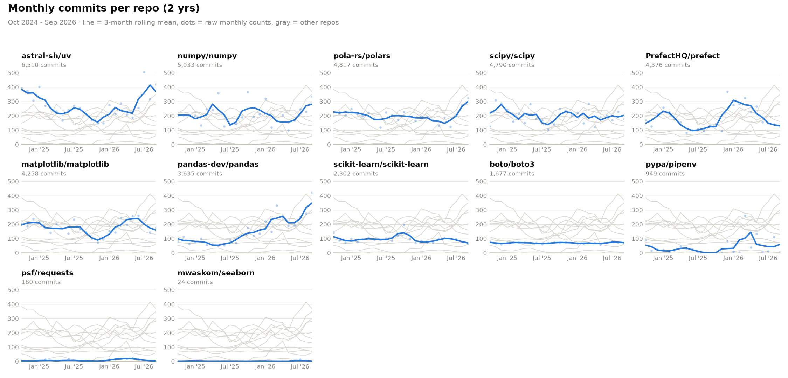
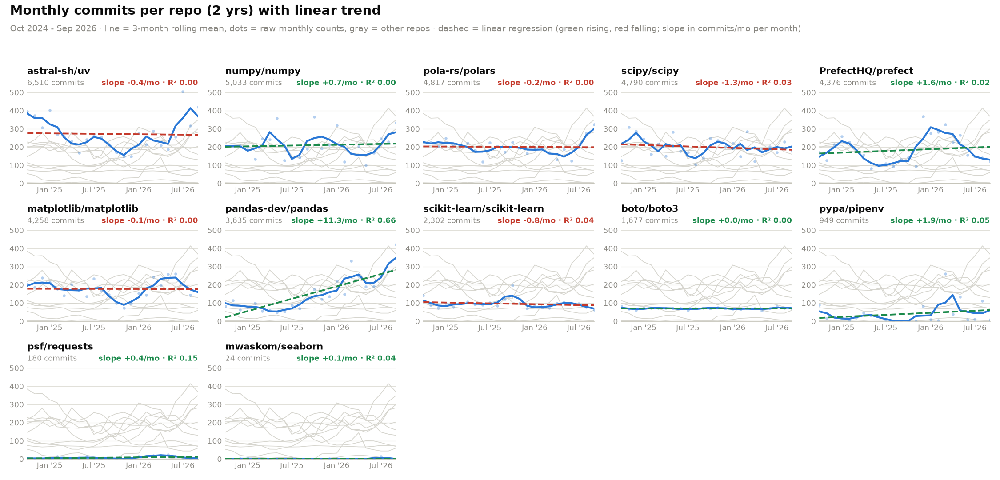
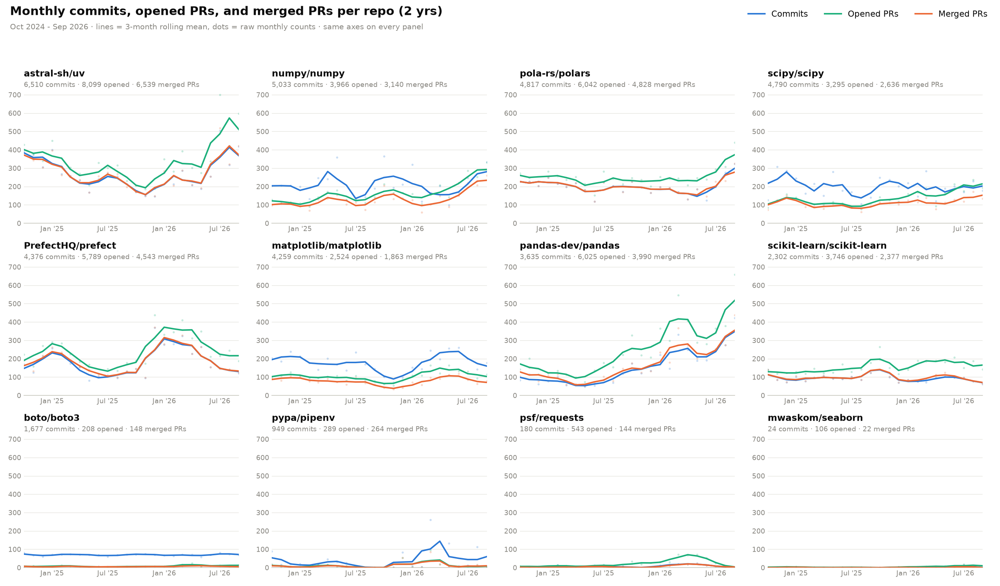

# Metrics for Measuring Project Health

Open Source Software (OSS) is a collaborative social project, and GitHub gives us several different views into the health and vitality of any project.

## Health Metrics

Here are SOME ways to ascertain software project health:

1. **Maintainer responsiveness.** Measure the median time to first review on new pull requests. A project that acknowledges contributions within days is healthy even if it doesn’t move fast, while one that leaves PRs unreviewed for months is often quietly abandoned.
2. **"Bus factor" and contributor diversity.** Look at how many people account for most of the commits and merges, and whether they come from more than one organization. If one person did 90% of the work, the project is fragile no matter how active it looks. GitHub’s Insights → Contributors graph is a good starting point.
3. **Recency and consistency of activity.** Check the date of the last commit and release, and whether activity is steady or bursty. Steady monthly activity is a better sign than a large total commit count from three years ago.
4. **Release practices.** Look for regular tagged releases, semantic versioning, a maintained changelog, and availability on PyPI or conda-forge. This shows the maintainers think about downstream users, not just their own development.
5. **PR backlog dynamics.** Compare opened, merged, and closed-unmerged PR counts, look at the age of the open backlog, and check how many open PRs have gone stale. A growing pile of old, unreviewed PRs suggests maintainers are overwhelmed.
6. **Pull request acceptance and review quality.** Look at the merge rate for PRs from outside contributors, time to merge, and whether PRs get substantive review comments rather than rubber-stamp approvals. This shows whether the project is genuinely open to the community.
7. **Testing and continuous integration.** Check for passing CI, test coverage, and testing across multiple Python versions and operating systems. For data science packages, also look at whether numerical results are tested against reference values.
8. **Documentation quality.** Assess the README, API reference, tutorials, example notebooks, and docstrings. Also check whether the docs are versioned and kept in sync with releases.
9. **Community and governance infrastructure.** Look for CONTRIBUTING, CODE_OF_CONDUCT, LICENSE, and GOVERNANCE files and PR templates. These indicate a project designed to outlive its founders.
10. **Dependency and security hygiene.** Check whether dependencies are reasonably current, whether Dependabot or similar is in use, whether there’s a security policy, and whether there are any unaddressed vulnerability advisories. The OpenSSF Scorecard automates much of this.
11. **Real-world adoption.** Look at download counts (pypistats.org (has an API), pepy.tech), GitHub’s “Used by” dependents graph, and academic citations. Adoption creates pressure and incentive to keep maintaining the package.
12. **Institutional backing and funding.** Check for fiscal sponsorship (such as NumFOCUS), GitHub Sponsors, grants, or company support. Funded maintainers are less likely to burn out.
13. **Raw volume metrics.** Commit counts, stars, forks, and watchers are useful context but rank last because they’re vanity metrics. Stars measure attention, not health, and commit counts depend heavily on individual commit habits.

## Comparison Metrics

Consider this plot that represents raw commit metrics for the last three years for a handful of popular packages:

Observations to consider:
- Package commit activity varies wildly between repositories, making comparison difficult.
- Bumpy or flat plots make it difficult to identify any trend(s) in the data.

Consider another plot displaying commit activity that includes a simple linear regression:

Observations:
- Trends upwards/downwards are now visible, but not all commits are "meaningful" in the same way.
- Upward trends over the last 1-2 years might also simply represent AI adoption in the development process, an even less accurate measure of meaningful health.

Consider this plot displaying several activity measures for the same projects:

Observations:
- Overlaid/multiple dimensions clearly displays a cohesive sense of "activity"
- However, activity may not all be meaningful activity.
- Regardless, cross-project comparisons must be undertaken carefully, since some packages are highly specialized with smaller user communities (but which might be more important to data engineers and scientists) while other packages are used more generally by many outside of data science.
