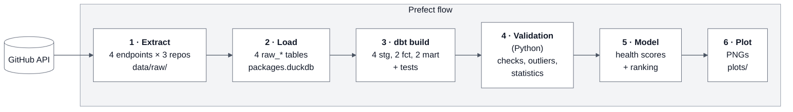

# Data Project 2 // Open Source Package Health: GitHub Data Pipeline

Released: Oct 23, 2026 | Due: Nov 02, 2026

> **Before you submit**, work through the [submission checklist](CHECKLIST.md). It lists every deliverable and what to submit in Canvas: your repository URL, and which extended items you attempted.

## Overview

In this project students will build one Prefect flow that pulls GitHub activity for three data science packages and ranks them from healthiest to least healthy development community. The project is worth **100 points**: **82** core, **8** extended, and **10** for an oral interview.

The flow must run end to end from a single entry point and contain six tasks: (1) extract from the GitHub API to JSON files, (2) load into DuckDB, (3) build and test staging, fact, and mart models with `dbt`, (4) validate the results in Python (no `dbt`), (5) model and rank, (6) plot. Task 3 is the only task that runs `dbt`. Each task is graded on its own, and each is designed to require real problem solving rather than a single library call.

Analysis window: **2024-01-01 through the time of each run.** The start date is fixed and shared by all projects; the end is open, so the window grows with every run (34 months as of October 2026). There is no end date to configure: anything GitHub returns already falls before the run.



## Package selection

Students will choose one of three preassigned sets of packages. Fixed sets equalize the API workload and guarantee a spread of community sizes so the ranking has something to find.

Each set mixes one large project with two smaller ones. The sets are balanced at roughly 7,000 PRs created and 5,500 PRs merged each across the analysis window (as of October 2026).

| Set | Large (heavy pagination) | Smaller |
| --- | --- | --- |
| A | `numpy/numpy` | `networkx/networkx`, `statsmodels/statsmodels` |
| B | `scikit-learn/scikit-learn` | `dask/dask`, `plotly/plotly.py` |
| C | `matplotlib/matplotlib` | `pydata/xarray`, `lightgbm-org/LightGBM` |

Indicate your selection A, B, or C in the Canvas quiz form.

## Create your repository

Do not fork this repository. Create your own copy from the template:

1. At the top of this repository's page, click **Use this template** → **Create a new repository**.
2. Set **Owner** to your personal GitHub account and give the repository a name.
3. Under visibility, select **Private**. GitHub may preselect **Public**; change it before continuing.
4. Click **Create repository**.
5. In your new repository, go to **Settings** → **Collaborators** → **Add people** and add `nmagee`, `elaineliu05`, and `tcusick8`.
6. Clone your new repository and do all of your work there.

> **Your repository must be private.** If you created it as public, change it now: **Settings** → **General** → **Danger Zone** → **Change repository visibility** → **Private**.

## General requirements — 13 points

| Criterion | Full credit requires | Pts |
| --- | --- | --- |
| Submission | All code, README, and plots are committed by the deadline in a **private** repository created from this template, with instructional staff added as collaborators (see [Create your repository](#create-your-repository)). | 1 |
| Single Prefect flow | One `@flow` orchestrates the six (6) core tasks in order; running the flow executes the whole pipeline, including `dbt build` (Task 3). The six tasks are the backbone of the flow: helper tasks (e.g. a per-request fetch with its own retries, or a task mapped over repos) and subflows are allowed to carry out the work of any of the six. Helper functions and classes may live in additional Python modules imported by the flow. | 3 |
| Execution | The flow runs to completion from a clean clone with only a GH token; experiences no unhandled exceptions. | 2 |
| Secrets | The GitHub PAT is read from an environment variable or Prefect Secret block; no token appears anywhere in the repository or its history. | 1 |
| Retries and error handling | Tasks use Prefect retries with backoff where failure is transient; HTTP and parsing errors are caught and handled with context. | 2 |
| Logging | Each task logs through the Prefect logger AND to its own log file in the project directory (dbt's own log should also be saved). | 1 |
| Code quality | Functions should be well-formed with `return`, appropriate flow control, and not unnecessarily verbose; files organized into folders (flow, dbt, plots). | 1 |
| Reproducibility | Dependencies pinned in `requirements.txt`, `Pipfile`, or `pyproject.toml`; README explains setup, run command, and expected runtime. | 1 |
| No cruft | The repository contains no database files, log files, raw API dumps, or caches. It contains no binaries, `venv` folder or virtualenv artifacts apart from dependency manifests (above) | 1 |

## How Tasks 1 and 2 fit together

Tasks 1 and 2 split the work of getting data from GitHub into DuckDB into two separate jobs:

```
GitHub API ──Task 1: Extract──▶ data/raw/*.json ──Task 2: Load──▶ packages.duckdb (raw_* tables) ──Task 3: dbt──▶ marts
```

- **Task 1 only talks to GitHub and writes files.** It never writes to DuckDB. Its job is to get every page of every endpoint onto disk, without exceeding the rate limit and without losing work if the run is interrupted.
- **Task 2 only reads files and writes to DuckDB.** It never calls the API. Its job is to load the landed files into raw tables so that re-running it never creates duplicates.

Because the raw responses stay on disk, you can fix a bug in Task 2 or any `dbt` model and rerun it without spending API quota. Add `data/` to `.gitignore`; landed data files must never be committed (see *No cruft* above).

> **A note on design**: Any task can be run in parallel using Prefect's `.map` feature. And, since you are working on 3 repositories at once, your code can theoretically work on more than one repo at a time, fetching multiple sources of data at the same time for each.

## Task 1: Extract from GitHub — 16 points

> **Build your flow** in the `main.py` module. All flow and logic should be there, unless you incorporate other modules via import.

Pull every required endpoint for all three repositories, across every page, and write each response page to disk as a JSON file. Restrict to the analysis window wherever the endpoint supports it (`since` for commits; no `until` is needed because the window runs through the present). Pull requests have no date filter: sort by `updated` descending and stop paginating once you pass the window start. Releases are small enough to fetch in full.

Example URL using `since`:

    https://api.github.com/repos/numpy/numpy/commits?since=2024-01-01T00:00:00Z&per_page=100

**Required endpoints** (per repo; `{r}` = `owner/name`):

| Endpoint | Path | Notes |
| --- | --- | --- |
| Commits | `GET /repos/{r}/commits?since=…` | |
| Pull requests | `GET /repos/{r}/pulls?state=all&sort=updated&direction=desc` | |
| PR reviews | `GET /repos/{r}/pulls/{number}/reviews` | One call per PR created in the window, merged or not (first review time). |
| Releases | `GET /repos/{r}/releases` | |

You may add other endpoints if you use them in a metric.

**Landing format.** Write one file per response page:

```
data/raw/<owner>__<repo>/<endpoint>/page_0001.json
```

Each file is a JSON object with the request metadata and the unmodified response body:

```json
{
  "repo": "numpy/numpy",
  "endpoint": "pulls",
  "url": "https://api.github.com/repos/numpy/numpy/pulls?state=all&sort=updated&direction=desc&per_page=100&page=1",
  "page": 1,
  "fetched_at": "2026-11-02T14:03:11Z",
  "data": [ ... ]
}
```

**Resume or start fresh?** Task 2 creates an empty marker file, `data/raw/_LOADED`, once everything in `data/raw/` has been loaded into DuckDB:

```python
Path("data/raw/_LOADED").touch()
```

At the start of each run, Task 1 checks for that file:

| What Task 1 finds | What it means | What Task 1 does |
| --- | --- | --- |
| No `_LOADED` file | The last run stopped before everything was loaded | **Resume:** keep the files, skip pages already on disk, fetch the rest |
| `_LOADED` file present | Everything on disk is already safe in DuckDB | **Start fresh:** delete `data/raw/`, then fetch only records updated since the `_load_state` watermark (see Task 2) |

On the very first run there is no `data/raw/` and no `_load_state`, so Task 1 fetches the full window.

| Criterion | Full credit requires | Pts |
| --- | --- | --- |
| Required endpoints | Every endpoint in the table above is fetched for all three repos. | 3 |
| Review calls | Reviews are fetched for every PR created in the window, merged or not. These per-PR calls multiply your request volume and are what push each set past the hourly limit. | 3 |
| Pagination | Follows the `Link` header (`rel="next"`) with `per_page=100` until no next page remains. Record counts are logged per endpoint per repo. | 3 |
| Primary rate limit | Reads `X-RateLimit-Remaining` and `X-RateLimit-Reset` on every response and sleeps until the reset time before the budget reaches zero. The 5,000 requests/hour limit cannot be raised. | 3 |
| Other HTTP errors | Handles 403/429 (secondary rate limits; honor `Retry-After`) and 5xx errors using Prefect `retries` and `retry_delay_seconds` on the appropriate task(s). | 1 |
| Landing files | Every response page is written in the format above, with exactly one file per page. | 1 |
| Resumability | If a run is interrupted, the next run sees no `_LOADED` file, keeps what is in `data/raw/`, and skips pages already on disk instead of starting over. Show this in your README with log excerpts from an interrupted run and its resumed run. Tip: interrupt your first full run partway through (Ctrl-C) and restart it; resuming costs no extra quota. Consider what happens if a crash lands while a page file is half-written: your resume logic should be able to recover from that without re-fetching what it already has (for example, by writing to a temp file and renaming it when complete, or by re-fetching only pages that fail to parse). | 2 |

## Task 2: Load to DuckDB — 9 points

Read the landed JSON files in `data/raw/` and load them into raw tables in `packages.duckdb`. `dbt` builds everything downstream from these tables in Task 3.

**Raw table design.** Create one table per endpoint (`raw_commits`, `raw_pull_requests`, `raw_pr_reviews`, and so on). Each row is **one record** (one commit, one PR, one review), not one page. Each table has a few typed key columns and the full record as JSON:

| Column | Type | Description |
| --- | --- | --- |
| `repo` | VARCHAR | `owner/name` |
| `id` | VARCHAR or BIGINT | The record's natural key (see below) |
| `updated_at` | TIMESTAMP | From the record, where it has one |
| `fetched_at` | TIMESTAMP | From the landing file |
| `source_file` | VARCHAR | Path of the landing file the row came from |
| `payload` | JSON | The complete record as returned by GitHub |

Natural keys: commits → `sha`; PRs → `number`; reviews and releases → `id`. Primary key is `(repo, id)`.

Leave the remaining fields inside `payload`. Your `dbt` staging models (Task 3) extract the fields you need, so if you later find you need another field you only change a model, not re-fetch from the API.

**Load state.** Keep a `_load_state` table with one row per repo and endpoint, recording the newest `updated_at` loaded and when the load finished. Update it only after every file in `data/raw/` has loaded, and then create the `_LOADED` marker (see *Resume or start fresh?* in Task 1). On the next run, Task 1 reads `_load_state` to set `since` and to decide where to stop paginating. Think of this table as tracking every successful action in this task, so that any hiccup does not require a full restart.

| Criterion | Full credit requires | Pts |
| --- | --- | --- |
| Raw tables | One table per endpoint, one row per record, with the columns above. Every `dbt` model can be rebuilt from these tables without calling the API. | 3 |
| Idempotent loads | Loads upsert on `(repo, id)` (e.g. `INSERT OR REPLACE` or `MERGE`), never blind inserts. Running Task 2 twice on the same files produces identical row counts; show both counts in the log. | 3 |
| Incremental loads | A second flow run requests only records updated since the `_load_state` watermark (review calls only for new or updated PRs), and Task 2 upserts them into the existing tables. Log the request count for a full run and an incremental run. | 3 |

## Task 3: `dbt` transformations and tests — 12 points

A `dbt` project in the repository turns raw JSON into tested staging models and marts with precalculated measures. The Prefect flow runs `dbt build` and fails if any model or test fails. This is the only place in the flow where `dbt` runs. Little cleaning is needed; the work is in the derived measures.

A `dbt` Reference is available [here](DBT-REFERENCE.md).

Suggested models (students may add more). Field names refer to the GitHub JSON in `payload` (e.g. `payload->>'created_at'`). **Run time** means `max(fetched_at)` in the raw tables, so a rebuild without new data gives the same results. Convert durations with `date_diff('second', start, end) / 3600.0` for hours or `date_diff('day', start, end)` for days.

| Model | Grain | Precalculated columns |
| --- | --- | --- |
| `stg_*` | One per raw endpoint | <ul><li>**All models:** cast timestamps with `::TIMESTAMPTZ` (GitHub returns UTC); keep the latest row per `(repo, id)` using `qualify row_number() over (partition by repo, id order by fetched_at desc) = 1`.</li><li>**Bot rule:** `is_bot = user.type = 'Bot' OR user.login LIKE '%[bot]'`. Apply it to the PR author, the reviewer, and the commit author.</li><li>`stg_commits`: `sha`, `author.login` (can be null when the commit email isn't linked to an account; `is_bot` is then false), `committed_at` from `commit.author.date`.</li><li>`stg_pull_requests`: `number`, `user.login`, `state`, `created_at`, `updated_at`, `closed_at`, `merged_at`.</li><li>`stg_pr_reviews`: `id`, `pr_number` (parse the trailing number from `pull_request_url`), `user.login`, `state`, `submitted_at`. Drop `PENDING` reviews; they have no `submitted_at`.</li><li>`stg_releases`: `id`, `tag_name`, `published_at`, `prerelease`. Drop rows where `draft` is true.</li></ul> |
| `fct_pull_requests` | One row per PR created on or after 2024-01-01 | <ul><li>`is_merged`: `merged_at IS NOT NULL`.</li><li>`is_closed_unmerged`: `state = 'closed' AND merged_at IS NULL`.</li><li>`is_open`: `state = 'open'` (open at run time).</li><li>`first_review_at`: `min(submitted_at)` from `stg_pr_reviews` for this PR, excluding reviews by the PR author and by bots.</li><li>`hours_to_first_review`: from `created_at` to `first_review_at`. NULL if never reviewed.</li><li>`reviewed_within_7d`: `hours_to_first_review <= 168`. False if never reviewed.</li><li>`hours_to_merge`: from `created_at` to `merged_at`. NULL unless merged.</li><li>`hours_to_close`: from `created_at` to `closed_at`, whether merged or not. NULL if open.</li><li>`is_stale`: `is_open AND updated_at < run time − 180 days`.</li><li>`has_approving_review`: any non-author, non-bot review with `state = 'APPROVED'`.</li></ul> |
| `fct_releases` | One row per published release on or after 2024-01-01 | <ul><li>`days_since_previous`: `date_diff('day', lag(published_at) over (partition by repo order by published_at), published_at)`. Compute the `lag` **before** filtering to the window, so the first release in the window still measures its gap to the release before it.</li><li>`is_prerelease`: `prerelease`.</li></ul> |
| `mart_repo_monthly` | Repo × month, January 2024 through the run month | <ul><li>Build the month list with `generate_series` (or a date spine) crossed with the three repos, so months with no activity show 0 instead of disappearing.</li><li>Count each event in the month it happened:<ul><li>`prs_opened`: by `date_trunc('month', created_at)`.</li><li>`prs_merged`: by `merged_at`.</li><li>`prs_closed_unmerged`: by `closed_at` where `is_closed_unmerged`.</li></ul></li><li>`merge_ratio`: `prs_merged / (prs_merged + prs_closed_unmerged)`. NULL when the denominator is 0.</li><li>`median_first_review_hours`: `median(hours_to_first_review)` of PRs opened that month (unreviewed PRs are NULL and fall out).</li><li>`median_merge_hours`: `median(hours_to_merge)` of PRs merged that month.</li><li>`commits`: count of `stg_commits` by `date_trunc('month', committed_at)`.</li><li>`active_contributors`: `count(DISTINCT login)` of non-bot PR authors who opened a PR that month.</li><li>`is_partial_month`: true for the run month.</li></ul> |
| `mart_health_inputs` | One row per repo | <ul><li>One column per metric you score in Task 5, named for the metric. Every column is a rate, share, median, or slope, never a raw count.</li><li>Examples:<ul><li>`commits_per_week`: total commits ÷ (days in window ÷ 7).</li><li>`pct_reviewed_within_7d`: `avg(reviewed_within_7d::INT)` over PRs created at least 7 days before run time.</li><li>`median_hours_to_merge`: from `fct_pull_requests`.</li><li>`commit_trend`: `regr_slope(commits, month_index)` over complete months of `mart_repo_monthly`.</li><li>`releases_per_year`: releases ÷ (days in window ÷ 365.25).</li></ul></li></ul> |

| Criterion | Full credit requires | Pts |
| --- | --- | --- |
| Staging models | One staging model per raw endpoint with typed columns, deduplication, and bot flagging; the bot rule is documented. | 2 |
| Fact marts | `fct_pull_requests` and `fct_releases` built with the precalculated durations and flags above. | 3 |
| Aggregate marts | `mart_repo_monthly` and `mart_health_inputs` feed Tasks 4–6 directly; no downstream task recomputes durations in Python. | 2 |
| Open items | PRs still open at run time are kept and marked open, never dropped or given a fake close date. The README explains how medians treat them. | 1 |
| Generic tests | `unique` and `not_null` on every primary key, `relationships` from reviews to pull requests, `accepted_values` on state columns. | 1 |
| Singular tests | Custom SQL tests assert no PR closed or merged before it was created, and no review submitted before its PR was created. Results print to screen and log. | 2 |
| Documentation | `schema.yml` describes every mart and column; raw tables are declared as dbt sources. | 1 |

## Task 4: Testing and validation — 9 points

**Task 4 is written in Python and does not run `dbt`.** It runs after Task 3 and uses what Task 3 built as its input. In a Python `@task`, connect to `packages.duckdb` and query the raw tables, staging models, and marts directly with SQL (and pandas or polars if you like), and read the landed JSON files in `data/raw/`. The task confirms that nothing was lost between stages and summarizes the data before modeling. If any check fails, raise an exception so the flow fails.

Task 4 does not repeat Task 3's work. Task 3's `dbt` tests check that each model is internally correct (unique keys, valid states, dates in order). Task 4 checks the pipeline end to end, from landed files to raw tables to staging models, and describes the data.

| Criterion | Full credit requires | Pts |
| --- | --- | --- |
| Completeness checks | For each repo and endpoint, every distinct `(repo, id)` record in `data/raw/` appears in the raw table, and the raw table's row count matches its staging model. Every repo has commits in every complete month of the window (the current, partial month is exempt). Any mismatch fails the task. | 3 |
| Outlier detection | Scan time to merge and weekly commits for values far outside the typical range (for example, a PR open for years or a week with a burst of automated commits). State the cutoff you used, list the records it flags, and say whether you keep, cap, or drop them, and why. | 3 |
| Descriptive statistics | Per repo: median and 90th percentile time to first review and time to merge; commits per week; releases per year. Read durations from the marts (do not recompute them). Printed to screen and log. | 3 |

Medians and percentiles are required because these durations are heavily right-skewed; a mean alone earns no credit.

## Task 5: Health modeling and ranking — 14 points

Students build a composite health score from at least four metrics spanning at least three dimensions, then rank the three repos.

| Dimension | Example metrics |
| --- | --- |
| Activity | Commits per week; trend slope over the window |
| Responsiveness | Median time to first PR review; share of PRs reviewed within 7 days; share of merged PRs with an approving review |
| Throughput | PRs merged ÷ PRs opened per month; merge rate (merged ÷ closed); median time to merge |
| Backlog | Open-PR growth rate; share of open PRs with no activity in 180+ days |
| Release cadence | Releases per year; regularity (coefficient of variation of days between releases) |
| Contributor base | Active PR authors per quarter; bus factor (fewest authors accounting for 50% of merged PRs) |

Stars and forks measure popularity, not health, and do not count toward the four metrics.

| Criterion | Full credit requires | Pts |
| --- | --- | --- |
| Metric design | Four or more metrics across three or more dimensions, read from `mart_health_inputs`, each with a written definition and a stated direction (higher or lower is healthier). | 4 |
| Size normalization | Metrics are normalized so large projects do not win by volume alone (per-contributor rates, ratios, or ranks rather than raw counts). | 3 |
| Scoring model | Metrics are standardized (z-score, min-max, or rank) and combined with weights the student justifies in writing. | 4 |
| Trend component | At least one metric captures direction of change (for example, a regression slope over the full window), not only a level. | 2 |
| Ranking output | A ranked table with score, rank, and per-dimension subscores prints to screen and log and is written back to the database. | 1 |

## Task 6: Multi-dimensional plots — 9 points

The flow saves at least three plots as PNG to a `plots/` directory, committed to the repository. Each plot shows three or more dimensions at once.

| Criterion | Full credit requires | Pts |
| --- | --- | --- |
| Dimension profile | A radar chart or small-multiples bar chart showing all three repos across every scored dimension. The plot also shows your final ranking, with repos ordered from healthiest to least healthy (for example, in the legend or panel order, labeled with rank and score). | 2 |
| Trends over time | Monthly small multiples from `mart_repo_monthly` (one panel per metric, one line per repo) covering the full window. | 3 |
| Relationship plot | A scatter or bubble chart encoding at least three variables (for example, x = time to first review, y = merge rate, size = active contributors, color = repo). | 2 |
| Presentation | Titles, labeled axes with units, a consistent color per repo across all plots, and a one-paragraph interpretation of each plot in the README. | 2 |

## Extended process — 8 points

These items separate strong submissions from complete ones.

| Criterion | Full credit requires | Pts |
| --- | --- | --- |
| GraphQL ingestion | Rewrite PR and review ingestion against the [**GitHub GraphQL API**](https://docs.github.com/en/graphql) with cursor pagination, tracking the 5,000-point hourly budget from the `rateLimit` field. Log request counts and runtime for REST vs. GraphQL. One GraphQL query can return 100 PRs with their first review, replacing about 100 REST calls. Done early, this cuts a full run from hours to minutes. | 3 |
| Concurrent fetching | Use Prefect task mapping or async requests to fetch repos in parallel while a shared limiter keeps total usage under the quota. | 2 |
| Scheduled deployment | A Prefect deployment with a monthly schedule (the 28th) runs the incremental flow; the `DEPLOYMENTS.md` file shows the deployment command and the log of one run you trigger manually from the Prefect UI (the first scheduled run may not occur before the due date). [Read more](DEPLOYMENTS.md). | 2 |
| API Odometer | Implement an overall tracking mechanism that tracks the total number of API requests per flow run. | 1 |

## Oral interview — 10 points

After submission, each student has a 5-minute interview about their own repository. Expect questions about specific parts of your code and the decisions behind them. You are responsible for understanding everything you submit, including any code produced with AI tools.

| Criterion | Full credit requires | Pts |
| --- | --- | --- |
| Code walkthrough | Explains how a piece of code chosen by the interviewer works. | 5 |
| Design decisions | Justifies a choice they made (for example, metric weights or outlier treatment). | 5 |

Points earned in other sections may be reduced for any component a student cannot explain.

## Point summary

| Section | Points | Score |
| --- | --- | --- |
| General requirements | 13 |  |
| Task 1: Extract from GitHub | 16 |  |
| Task 2: Load to DuckDB | 9 |  |
| Task 3: `dbt` transformations and tests | 12 |  |
| Task 4: Testing and validation | 9 |  |
| Task 5: Health modeling and ranking | 14 |  |
| Task 6: Multi-dimensional plots | 9 |  |
| Extended process | 8 |  |
| Oral interview | 10 |  |
| **Total** | **100** |  |

## Grading Notes

As discussed in class I will NOT be grading on the following:

- Speed/latency of your solution. Fast is great but unnecessary in this context.
- Optimization. It should get the job done, even if there are more refined ways to structure it.
- The final ranking itself. There is no correct order; grading is based on your metric definitions and weight justification.
- Exact record counts. The window grows with each run and GitHub data shifts over time, so your counts will not match other students' exactly. Counts must only reconcile within your own pipeline (Task 4).
- Library and style choices beyond the required tools. `requests` vs. `httpx`, pandas vs. polars, matplotlib vs. plotly, sync vs. async, and formatting are your call, as long as Prefect, DuckDB, and `dbt` are used as specified.

## Reference

[**GitHub API Documentation**](https://docs.github.com/en/rest?apiVersion=2026-03-10)
- [Commits](https://docs.github.com/en/rest/commits/commits?apiVersion=2026-03-10)
- [Pull Requests](https://docs.github.com/en/rest/pulls/pulls?apiVersion=2026-03-10)
- [PR Reviews](https://docs.github.com/en/rest/pulls/reviews?apiVersion=2026-03-10) | [Sample Code](https://github.com/uvasds-systems/ds3022/blob/main/04_apis/09_github_pr_vals.py)
- [Releases](https://docs.github.com/en/rest/releases/releases?apiVersion=2026-03-10)

Other:
- [GitHub Pagination](https://docs.github.com/en/rest/using-the-rest-api/using-pagination-in-the-rest-api) | [Sample Code](https://github.com/uvasds-systems/ds3022/blob/main/04_apis/05_pagination.py)
- [GitHub Ratelimits](https://docs.github.com/en/rest/using-the-rest-api/rate-limits-for-the-rest-api) | [Sample Code](https://github.com/uvasds-systems/ds3022/blob/main/04_apis/07_github_api_limits.py)
- [GitHub GraphQL](https://docs.github.com/en/graphql/guides/forming-calls-with-graphql) | [Sample Code](https://github.com/uvasds-systems/ds3022/blob/main/04_apis/08_github_graphql_api.py)
- [GitHub GraphQL Rate Limits](https://docs.github.com/en/graphql/overview/rate-limits-and-query-limits-for-the-graphql-api)
- [Prefect Documentation](https://docs.prefect.io/v3/get-started)
- [DBT Documentation](https://docs.getdbt.com/docs/introduction)
- [dbt DuckDB Adapter Setup](https://docs.getdbt.com/docs/core/connect-data-platform/duckdb-setup)

