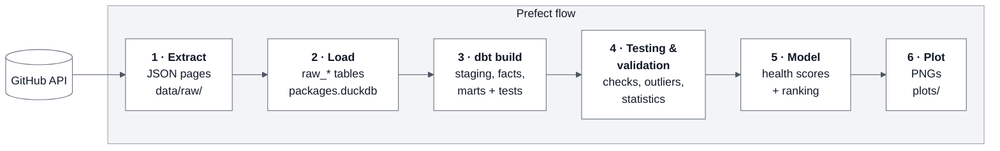

# Data Project 2 // Open Source Package Health: GitHub Data Pipeline

Released: Oct 23, 2026

## Overview

In this project students will build one Prefect flow that pulls GitHub activity for five data science packages and ranks them from healthiest to least healthy development community. The project is worth 100 points: 82 core, 8 extended, and 10 for an oral interview.

The flow must run end to end from a single entry point and contain six tasks: (1) extract from the GitHub API to JSON files, (2) load into DuckDB, (3) transform and test with `dbt`, (4) test and validate, (5) model and rank, (6) plot. Each task is graded on its own, and each is designed to require real problem solving rather than a single library call.

Analysis window: Three years **2023-01-01 through 2025-12-31** (36 months). A fixed window keeps results reproducible and comparable across projects.



## Package selection

Students will choose one of three preassigned sets of packages. Fixed sets equalize the API workload, guarantee a spread of community sizes so the ranking has something to find, and let you grade results against a known reference run.

Each set mixes two very large projects, two mid-size projects, and one smaller or maintainer-concentrated project.

| Set | Large (heavy pagination) | Mid-size | Smaller / concentrated |
| --- | --- | --- | --- |
| A | `numpy/numpy`, `scikit-learn/scikit-learn` | `dask/dask`, `mwaskom/seaborn` | `vega/altair` |
| B | `pandas-dev/pandas`, `matplotlib/matplotlib` | `statsmodels/statsmodels`, `dmlc/xgboost` | `networkx/networkx` |
| C | `scipy/scipy`, `pola-rs/polars` | `plotly/plotly.py`, `microsoft/LightGBM` | `pydata/xarray` |

Indicate your selection A, B, or C in the Canvas quiz form.

## Create your repository

Do not fork this repository. Create your own copy from the template:

1. At the top of this repository's page, click **Use this template** → **Create a new repository**.
2. Set **Owner** to your personal GitHub account and give the repository a name.
3. Under visibility, select **Private**. GitHub may preselect **Public**; change it before continuing.
4. Click **Create repository**.
5. In your new repository, go to **Settings** → **Collaborators** → **Add people** and add `nmagee`, `elaineliu05`, and `tcusick8`.
6. Clone your new repository and do all of your work there.

> **Your repository must be private.** If you created it as public, change it now: **Settings** → **General** → **Danger Zone** → **Change repository visibility** → **Private**.

## General requirements — 13 points

| Criterion | Full credit requires | Pts |
| --- | --- | --- |
| Submission | All code, README, and plots are committed by the deadline in a **private** repository created from this template, with instructional staff added as collaborators (see [Create your repository](#create-your-repository)). | 1 |
| Single Prefect flow | One `@flow` orchestrates exactly six (6) `@task` functions in order; running the flow executes the whole pipeline, including `dbt build`. Students may include additional pages or classes that are incorporated into the flow. | 3 |
| Execution | The flow runs to completion from a clean clone with only a GH token; experiences no unhandled exceptions. | 2 |
| Secrets | The GitHub PAT is read from an environment variable or Prefect Secret block; no token appears anywhere in the repository or its history. | 1 |
| Retries and error handling | Tasks use Prefect retries with backoff where failure is transient; HTTP and parsing errors are caught and handled with context. | 2 |
| Logging | Each task logs through the Prefect logger AND to its own log file in the project directory (dbt's own log should also be saved). | 1 |
| Code quality | Functions should be well-formed with `return`, appropriate flow control, and not unnecessarily verbose; files organized into folders (flow, dbt, plots). | 1 |
| Reproducibility | Dependencies pinned in `requirements.txt`, `Pipfile`, or `pyproject.yaml`); README explains setup, run command, and expected runtime. | 1 |
| No cruft | The repository contains no database files, log files, raw API dumps, or caches. It contains no binaries, `venv` folder or virtualenv artifacts apart from dependency manifests (above) | 1 |

## How Tasks 1 and 2 fit together

Tasks 1 and 2 split the work of getting data from GitHub into DuckDB into two separate jobs:

```
GitHub API ──Task 1: Extract──▶ data/raw/*.json ──Task 2: Load──▶ packages.duckdb (raw_* tables) ──Task 3: dbt──▶ marts
```

- **Task 1 only talks to GitHub and writes files.** It never writes to DuckDB. Its job is to get every page of every endpoint onto disk, without exceeding the rate limit and without losing work if the run is interrupted.
- **Task 2 only reads files and writes to DuckDB.** It never calls the API. Its job is to load the landed files into raw tables so that re-running it never creates duplicates.

Because the raw responses stay on disk, you can fix a bug in Task 2 or any `dbt` model and rerun it without spending API quota. Add `data/` to `.gitignore`; landed data files must never be committed (see *No cruft* above).

## Task 1: Extract from GitHub — 16 points

> **Build your flow** in the `main.py` module. All flow and logic should be there, unless you incorporate other modules via import.

Pull every required endpoint for all five repositories, across every page, and write each response page to disk as a JSON file. Restrict to the analysis window wherever the endpoint supports it (`since`/`until` for commits, `since` for issues and comments). For endpoints without date filters, sort by `updated` descending and stop paginating once you pass the window start.

Example URL using `since` and `until`:

    https://api.github.com/repos/numpy/numpy/commits?since=2023-01-01T00:00:00Z&until=2025-12-31T23:59:59Z&per_page=100

**Required endpoints** (per repo; `{r}` = `owner/name`):

| Endpoint | Path | Notes |
| --- | --- | --- |
| Repository | `GET /repos/{r}` | One call. Repository metadata (description, creation date, default branch). |
| Community profile | `GET /repos/{r}/community/profile` | One call. CONTRIBUTING, CODE_OF_CONDUCT, etc. |
| Commits | `GET /repos/{r}/commits?since=…&until=…` | |
| Issues | `GET /repos/{r}/issues?state=all&since=…` | Also returns PRs. Separate them using the `pull_request` key. |
| Issue comments | `GET /repos/{r}/issues/comments?since=…` | Repo-wide list, used to compute first response time on issues. |
| Pull requests | `GET /repos/{r}/pulls?state=all&sort=updated&direction=desc` | |
| PR detail | `GET /repos/{r}/pulls/{number}` | One call per merged PR in the window (lines changed). |
| PR reviews | `GET /repos/{r}/pulls/{number}/reviews` | One call per merged PR in the window (first review time). |
| Releases | `GET /repos/{r}/releases` | |
| Contributors | `GET /repos/{r}/contributors` | |

You may add other endpoints if you use them in a metric.

**Landing format.** Write one file per response page:

```
data/raw/<run_id>/<owner>__<repo>/<endpoint>/page_0001.json
```

Each file is a JSON object with the request metadata and the unmodified response body:

```json
{
  "repo": "numpy/numpy",
  "endpoint": "issues",
  "url": "https://api.github.com/repos/numpy/numpy/issues?state=all&per_page=100&page=1",
  "page": 1,
  "fetched_at": "2026-11-02T14:03:11Z",
  "data": [ ... ]
}
```

| Criterion | Full credit requires | Pts |
| --- | --- | --- |
| Required endpoints | Every endpoint in the table above is fetched for all five repos. Issues and PRs are separated. | 3 |
| Detail calls | PR detail and reviews are fetched for every merged PR in the window. These calls multiply your request volume and are what push the large repos past the hourly limit. | 3 |
| Pagination | Follows the `Link` header (`rel="next"`) with `per_page=100` until no next page remains. Record counts are logged per endpoint per repo. | 3 |
| Primary rate limit | Reads `X-RateLimit-Remaining` and `X-RateLimit-Reset` on every response and sleeps until the reset time before the budget reaches zero. The 5,000 requests/hour limit cannot be raised. | 3 |
| Other HTTP errors | Handles 403/429 (secondary rate limits; honor `Retry-After`) and 5xx errors using Prefect `retries` and `retry_delay_seconds` on the appropriate task(s). | 1 |
| Landing files | Every response page is written in the format above, with exactly one file per page. | 1 |
| Resumability | If a run is interrupted, the next run resumes the unfinished `<run_id>` folder and skips pages already on disk instead of starting over. Show this in your README with log excerpts from an interrupted run and its resumed run. | 2 |

## Task 2: Load to DuckDB — 9 points

Read the landed JSON files from the current run folder and load them into raw tables in `packages.duckdb`. `dbt` builds everything downstream from these tables in Task 3.

**Raw table design.** Create one table per endpoint (`raw_commits`, `raw_issues`, `raw_pull_requests`, and so on). Each row is **one record** (one commit, one issue, one review), not one page. Each table has a few typed key columns and the full record as JSON:

| Column | Type | Description |
| --- | --- | --- |
| `repo` | VARCHAR | `owner/name` |
| `id` | VARCHAR or BIGINT | The record's natural key (see below) |
| `updated_at` | TIMESTAMP | From the record, where it has one |
| `fetched_at` | TIMESTAMP | From the landing file |
| `source_file` | VARCHAR | Path of the landing file the row came from |
| `payload` | JSON | The complete record as returned by GitHub |

Natural keys: commits → `sha`; issues and PRs → `number`; comments, reviews, and releases → `id`; contributors → `login`. Primary key is `(repo, id)`.

Leave the remaining fields inside `payload`. Your `dbt` staging models (Task 3) extract the fields you need, so if you later find you need another field you only change a model, not re-fetch from the API.

**Load state.** Keep a `_load_state` table with one row per repo and endpoint, recording the newest `updated_at` loaded and when the load finished. Write it only after a run folder loads completely, and then write a `_LOADED` marker file into that run folder. Task 1 reads `_load_state` on the next run to set `since` and to decide where to stop paginating; it treats any run folder without `_LOADED` as unfinished and resumes it. Think of this table as tracking every successful action in this task, so that any hiccup does not require a full restart.

| Criterion | Full credit requires | Pts |
| --- | --- | --- |
| Raw tables | One table per endpoint, one row per record, with the columns above. Every `dbt` model can be rebuilt from these tables without calling the API. | 3 |
| Idempotent loads | Loads upsert on `(repo, id)` (e.g. `INSERT OR REPLACE` or `MERGE`), never blind inserts. Running Task 2 twice on the same run folder produces identical row counts; show both counts in the log. | 3 |
| Incremental loads | A second flow run requests only records updated since the `_load_state` watermark (detail calls only for new or updated merged PRs), and Task 2 upserts them into the existing tables. Log the request count for a full run and an incremental run. | 3 |

## Task 3: `dbt` transformations and tests — 12 points

A `dbt` project in the repository turns raw JSON into tested staging models and marts with precalculated measures. The Prefect flow runs `dbt build` and fails if any model or test fails. Little cleaning is needed; the work is in the derived measures.

A `dbt` Reference is available [here](DBT-REFERENCE.md).

Suggested models (students may add more):

| Model | Grain | Precalculated columns |
| --- | --- | --- |
| `stg_*` | One per raw endpoint | Typed columns, UTC timestamps, deduplicated on natural key, `is_bot` flag |
| `fct_issues` | One row per issue | Hours to first response, hours to close, open at window end, stale (no activity in 180+ days) |
| `fct_pull_requests` | One row per PR | Hours to first review, hours to merge, merged flag, lines changed, first-time contributor flag |
| `fct_releases` | One row per release | Days since previous release, major/minor/patch from tag, prerelease flag |
| `dim_contributors` | One row per author per repo | First and last contribution date, active quarters, retained 6 months after first contribution |
| `mart_repo_monthly` | Repo × month | Issues opened and closed, close ratio, median response and merge hours, commits, active contributors |
| `mart_health_inputs` | One row per repo | Every metric Task 5 scores, already size-normalized |

| Criterion | Full credit requires | Pts |
| --- | --- | --- |
| Staging models | One staging model per raw endpoint with typed columns, deduplication, and bot flagging; the bot rule is documented. | 2 |
| Fact and dimension marts | `fct_issues`, `fct_pull_requests`, `fct_releases`, and `dim_contributors` built with the precalculated durations and flags above. | 3 |
| Aggregate marts | `mart_repo_monthly` and `mart_health_inputs` feed Tasks 4–6 directly; no downstream task recomputes durations in Python. | 2 |
| Open items | Issues and PRs still open at window end are kept and marked open, never dropped or given a fake close date. The README explains how medians treat them. | 1 |
| Generic tests | `unique` and `not_null` on every primary key, `relationships` from facts to repos and contributors, `accepted_values` on state columns. | 1 |
| Singular tests | Custom SQL tests assert no issue closed before it opened, no PR merged before it was created, and every timestamp falls inside the window. Results print to screen and log. | 2 |
| Documentation | `schema.yml` describes every mart and column; raw tables are declared as dbt sources. | 1 |

## Task 4: Testing and validation — 9 points

This task reads the `dbt` marts, confirms that nothing was lost between stages, and summarizes the data before modeling. It fails the flow if a check fails.

| Criterion | Full credit requires | Pts |
| --- | --- | --- |
| Completeness checks | For each repo and endpoint, the number of distinct records matches from stage to stage (landed JSON → raw tables → staging models), counting duplicates only once. Every repo has commits in every month of the window. Any mismatch fails the task. | 3 |
| Outlier detection | Scan time to close, PR size, and weekly commits for values far outside the typical range (for example, an issue open for years or a PR that changes 50,000 lines). State the cutoff you used, list the records it flags, and say whether you keep, cap, or drop them, and why. | 3 |
| Descriptive statistics | Per repo: median and 90th percentile time to first response, time to close, and time to merge; commits per week; releases per year; active contributors per quarter. Printed to screen and log. | 3 |

Medians and percentiles are required because these durations are heavily right-skewed; a mean alone earns no credit.

## Task 5: Health modeling and ranking — 14 points

Students build a composite health score from at least six metrics spanning at least four dimensions, then rank the five repos and show the ranking holds up.

| Dimension | Example metrics |
| --- | --- |
| Activity | Commits per week; trend slope over the window |
| Responsiveness | Median time to first response on issues; median time to first PR review |
| Throughput | Issues closed ÷ issues opened per month; PR merge rate; median time to merge |
| Backlog | Open-issue growth rate; share of open issues with no activity in 180+ days |
| Release cadence | Releases per year; regularity (coefficient of variation of days between releases) |
| Contributor base | Active contributors per quarter; bus factor (fewest people making 50% of commits); new-contributor retention after 6 months |
| Community health | Community profile files (CONTRIBUTING, CODE\_OF\_CONDUCT); `good first issue` usage; first-time contributor PRs merged |

Stars and forks measure popularity, not health, and do not count toward the six metrics.

| Criterion | Full credit requires | Pts |
| --- | --- | --- |
| Metric design | Six or more metrics across four or more dimensions, read from `mart_health_inputs`, each with a written definition and a stated direction (higher or lower is healthier). | 3 |
| Size normalization | Metrics are normalized so large projects do not win by volume alone (per-contributor rates, ratios, or ranks rather than raw counts). | 3 |
| Scoring model | Metrics are standardized (z-score, min-max, or rank) and combined with weights the student justifies in writing. | 3 |
| Trend component | At least one metric captures direction of change (for example, a regression slope over 36 months), not only a level. | 2 |
| Sensitivity analysis | The ranking is recomputed under at least two alternative weightings, or one metric left out at a time. The README states whether the top and bottom positions hold. | 2 |
| Ranking output | A ranked table with score, rank, and per-dimension subscores prints to screen and log and is written back to the database. | 1 |

## Task 6: Multi-dimensional plots — 9 points

The flow saves at least three plots as PNG to a `plots/` directory, committed to the repository. Each plot shows three or more dimensions at once.

| Criterion | Full credit requires | Pts |
| --- | --- | --- |
| Dimension profile | A radar chart or small-multiples bar chart showing all five repos across every scored dimension. The plot also shows your final ranking, with repos ordered from healthiest to least healthy (for example, in the legend or panel order, labeled with rank and score). | 2 |
| Trends over time | Monthly small multiples from `mart_repo_monthly` (one panel per metric, one line per repo) covering the full 36-month window. | 3 |
| Relationship plot | A scatter or bubble chart encoding at least three variables (for example, x = time to first response, y = close ratio, size = active contributors, color = repo). | 2 |
| Presentation | Titles, labeled axes with units, a consistent color per repo across all plots, and a one-paragraph interpretation of each plot in the README. | 2 |

## Extended process — 8 points

These items separate strong submissions from complete ones.

| Criterion | Full credit requires | Pts |
| --- | --- | --- |
| GraphQL ingestion | Rewrite PR and review ingestion against the [**GitHub GraphQL API**](https://docs.github.com/en/graphql) with cursor pagination, tracking the 5,000-point hourly budget from the `rateLimit` field. Log request counts and runtime for REST vs. GraphQL. | 3 |
| Concurrent fetching | Use Prefect task mapping or async requests to fetch repos in parallel while a shared limiter keeps total usage under the quota. | 2 |
| Scheduled deployment | A Prefect deployment with a weekly schedule runs the incremental flow; the `DEPLOYMENTS.md` file shows the deployment command and one scheduled run's log. [Read more](DEPLOYMENTS.md). | 2 |
| API Odometer | Implement an overall tracking mechanism that tracks the total number of API requests per flow run. | 1 |

## Oral interview — 10 points

After submission, each student has a 5-minute interview about their own repository. Expect questions about specific parts of your code and the decisions behind them. You are responsible for understanding everything you submit, including any code produced with AI tools.

| Criterion | Full credit requires | Pts |
| --- | --- | --- |
| Code walkthrough | Explains how a piece of code chosen by the interviewer works. | 5 |
| Design decisions | Justifies a choice they made (for example, metric weights or outlier treatment). | 5 |

Points earned in other sections may be reduced for any component a student cannot explain.

## Point summary

| Section | Points | Score |
| --- | --- | --- |
| General requirements | 13 |  |
| Task 1: Extract from GitHub | 16 |  |
| Task 2: Load to DuckDB | 9 |  |
| Task 3: `dbt` transformations and tests | 12 |  |
| Task 4: Testing and validation | 9 |  |
| Task 5: Health modeling and ranking | 14 |  |
| Task 6: Multi-dimensional plots | 9 |  |
| Extended process | 8 |  |
| Oral interview | 10 |  |
| **Total** | **100** |  |

## Reference

[**GitHub API Documentation**](https://docs.github.com/en/rest?apiVersion=2026-03-10)
- [Commits](https://docs.github.com/en/rest/commits/commits?apiVersion=2026-03-10)
- [Issues](https://docs.github.com/en/rest/issues/issues?apiVersion=2026-03-10)
- [Pull Requests (a special type of issue)](https://docs.github.com/en/rest/issues/issues?apiVersion=2026-03-10)
- [Releases](https://docs.github.com/en/rest/releases/releases?apiVersion=2026-03-10)
- [Contributors](https://docs.github.com/en/rest/repos/repos?apiVersion=2026-03-10#list-repository-contributors)

Other:
- [GitHub Pagination](https://docs.github.com/en/rest/using-the-rest-api/using-pagination-in-the-rest-api) | [Sample Code](https://github.com/uvasds-systems/ds3022/blob/main/04_apis/05_pagination.py)
- [GitHub Ratelimits](https://docs.github.com/en/rest/using-the-rest-api/rate-limits-for-the-rest-api) | [Sample Code](https://github.com/uvasds-systems/ds3022/blob/main/04_apis/07_github_api_limits.py)
- [GitHub GraphQL](https://docs.github.com/en/graphql/guides/forming-calls-with-graphql) | [Sample Code](https://github.com/uvasds-systems/ds3022/blob/main/04_apis/08_github_graphql_api.py)
- [GitHub GraphQL Rate Limits](https://docs.github.com/en/graphql/overview/rate-limits-and-query-limits-for-the-graphql-api)
- [Prefect Documentation](https://docs.prefect.io/v3/get-started)
- [DBT Documentation](https://docs.getdbt.com/docs/introduction)
- [dbt DuckDB Adapter Setup](https://docs.getdbt.com/docs/core/connect-data-platform/duckdb-setup)

